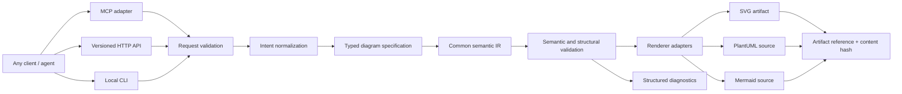

# Intent-to-SVG MCP/API/server — design proposal

- Status: Proposed
- Tracking issue: [#3 — Expose xuml intent-to-SVG generation as an MCP/API/server](https://github.com/bonsai/xuml/issues/3)

## Goal

Expose the same diagram-generation core through CLI, MCP, and HTTP API so that compatible clients can submit a natural-language intent and receive a validated SVG and its editable source. Local-first operation is the baseline; remote deployment is an optional hosting mode.

## Architecture

## Interface boundaries

### MCP tool

Initial tool name: `diagram_from_intent`.

Input should be a versioned JSON object with:
- `intent`: natural-language diagram request.
- `diagram_kind`: e.g. `class` or `architecture`.
- `formats`: one or more of `svg`, `puml`, `mmd`.
- `options`: bounded, typed rendering options.
- `context_refs`: optional references to source files or design artifacts.

Output should include:
- `request_id` and `schema_version`.
- `status` and structured diagnostics.
- `artifacts[]`: format, artifact reference/URI, content hash, and provenance.
- `semantic_model_ref` when the IR is persisted.

### HTTP API

Proposed endpoint: `POST /v1/diagrams`.

Use the same request and response schemas as MCP. Do not create separate business logic for MCP, HTTP, and CLI adapters. A later `GET /v1/artifacts/{id}` can retrieve persisted artifacts when remote storage is enabled.

### Shared core

1. Normalize the intent into a typed specification.
2. Validate diagram kind and rendering options.
3. Build or update the common semantic IR.
4. Validate semantic constraints before rendering.
5. Generate requested source and SVG artifacts.
6. Validate output, calculate content hashes, and return structured diagnostics.
7. Preserve last-known-good artifacts if a run fails.

## Runtime modes

- **Local:** CLI and optional local MCP/HTTP server; filesystem artifacts and SQLite index; works offline.
- **Remote:** stateless API adapter plus bounded workers; PostgreSQL for metadata and object storage for large artifacts.
- **Sync:** stable artifact references and JSONL events allow later synchronization without making cloud access a prerequisite.

## Reliability and security

- Set request-size, execution-time, concurrency, and output-size limits.
- Treat source text and natural-language intent as untrusted data, never executable instructions.
- Never execute generated code as part of diagram rendering.
- Avoid recording secrets or full prompt/source bodies in event logs by default.
- Return explicit unknowns and validation errors instead of fabricating structural facts.
- Handle malformed JSON, unsupported diagram kinds, renderer timeout/crash, and storage failure.
- Do not overwrite last-known-good outputs on failed validation.

## Delivery sequence

1. Define request, response, diagnostic, and artifact-reference schemas.
2. Implement the shared intent-to-spec/IR function and deterministic fixtures.
3. Add CLI invocation.
4. Add MCP adapter over the shared core.
5. Add HTTP API adapter over the same core.
6. Add optional remote worker/storage deployment and observability.

Implementation and acceptance criteria are tracked in Issue #3.
